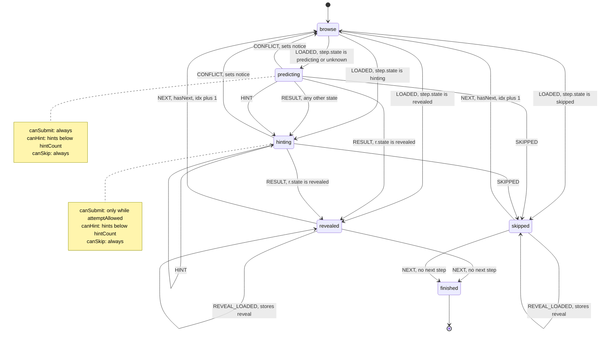
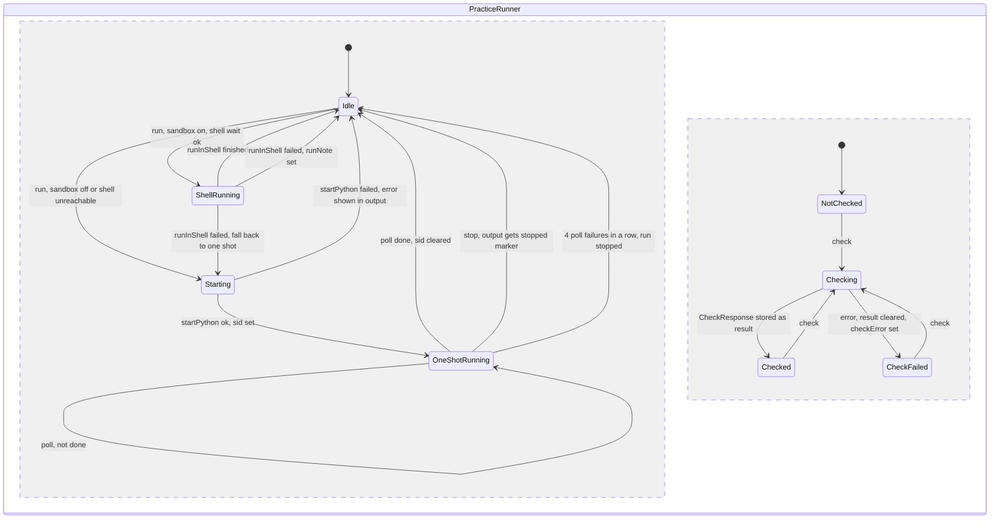
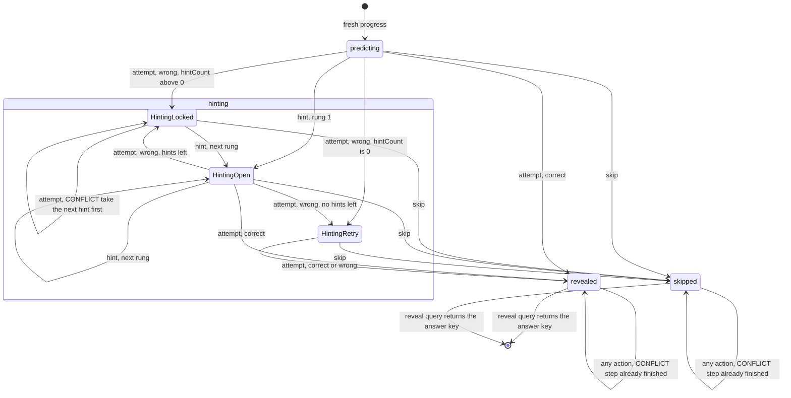

# State machines

Diagrams derived from the code. When a machine changes, change its diagram in the same PR.

## Lesson step machine (client)

Mirrors `apps/web/src/player/stepMachine.ts`, the XState machine behind one step of the player. `LOADED` carries the server's saved state, so a reload lands where the learner left off. The answer arrives only through `REVEAL_LOADED`, and that event is accepted only in `revealed` and `skipped`.

## Practice run (client)

Mirrors `apps/web/src/player/live/usePracticeRunner.ts`, with the result shapes from `apps/web/src/player/live/checkModel.ts`. Run and Check are independent flags in the hook, so the diagram has two regions. The derived flag `busy` is true in `Starting`, `OneShotRunning` and `ShellRunning`. `Idle` and `Checked` are the resting states. Editing the code drops lint findings but keeps the last Check result.

## Attempt, hint and reveal (server)

Mirrors `next` in `apps/api/src/attempts/machine.ts`, driven by `stepsRouter` in `apps/api/src/attempts/router.ts` (`attempt`, `hint`, `skip`, `reveal`). The stored state is one of `predicting`, `hinting`, `revealed` and `skipped`. The three `hinting` sub-states split on the stored flags: `attemptAllowed` and `retryAllowed`. Any action in `revealed` or `skipped` is a CONFLICT, and so is an attempt while `attemptAllowed` is false or a hint when none are left. `reveal` returns the answer key only in `revealed` or `skipped`, otherwise CONFLICT "Not revealed yet".

Side effects per transition, from `mutate` in the same router:

- A `hint` inserts a `hint_events` row and returns that rung's text.
- An `attempt` or `skip` inserts an `attempts` row. Only the first one for the learner and step is `observed`, and only an observed one triggers `applyObservations` (mastery). Later attempts never move mastery.
